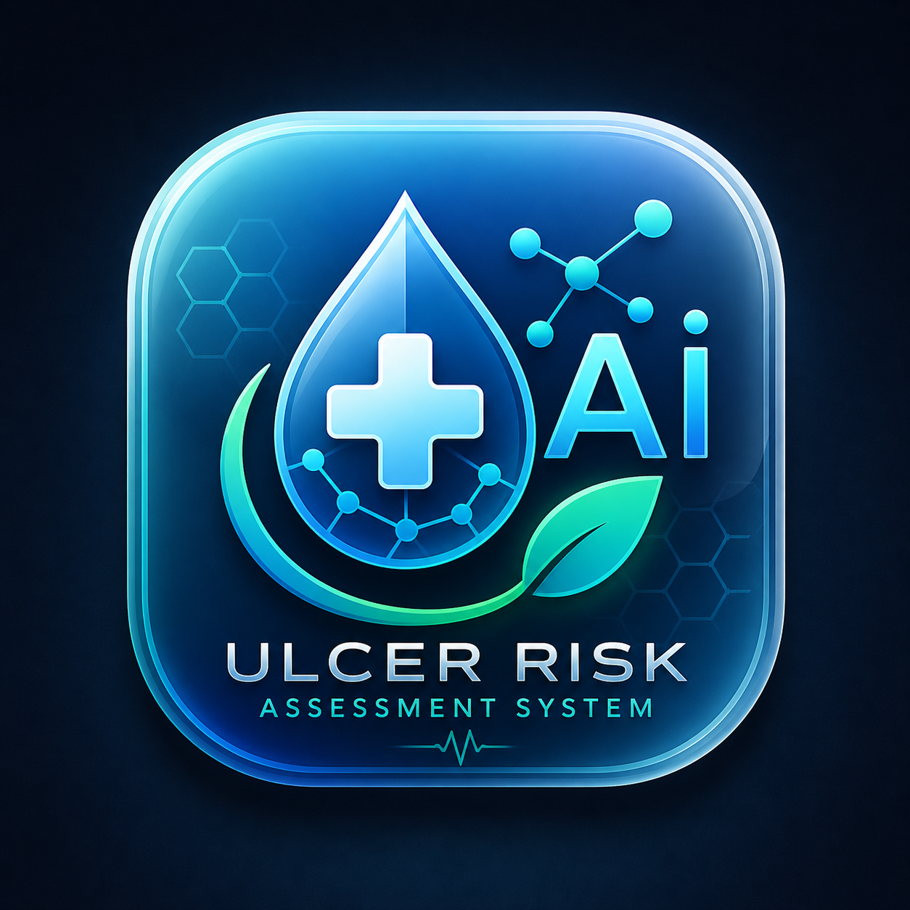

<div align="center">



# 🧬 Saliva-Based Ulcer Risk Assessment System
### *SURAS — a research prototype for oral ulcer risk estimation*

<br/>

[](https://python.org)
[](https://www.rust-lang.org)
[](https://developer.android.com)
[](https://riverbankcomputing.com/software/pyqt)
[](https://onnx.ai)
[](LICENSE)

<br/>

> **A research prototype that estimates oral ulcer risk from a small set of lifestyle and pH features. It is not a diagnostic device and is not clinically validated.**

<br/>

[📖 Overview](#-overview) • [✨ Features](#-features) • [🧠 Model](#-model) • [🚀 Getting Started](#-getting-started) • [📁 Structure](#-repository-structure) • [📚 Docs](#-documentation) • [⚠️ Disclaimer](#️-disclaimer)

</div>

---

## 📖 Overview

SURAS is a final-year academic project. It has two front ends that share the same
logic and the same model:

- a **PyQt5 desktop application**, and
- an **Android application** (Kotlin, Jetpack Compose).

Both collect the **same 14 inputs** — age, gender, six lifestyle answers and four
gastric-pH readings — and run them through a small machine-learning classifier to
produce a **risk estimate for research and decision support**.

> **Accuracy of this README.** Earlier versions described an algorithm
> ("SWBRA") built on IL-6, CRP, IgA, pH and protein. That algorithm is **not
> implemented** in the source code; the app does not collect those biomarkers.
> The README's SWBRA weights and bands are preserved in
> [`shared/swbra_spec.json`](shared/swbra_spec.json) and marked
> *documented-only*, with thresholds and units recorded as **UNKNOWN**. The apps
> show SWBRA as unavailable rather than inventing a score. See
> [`docs/OPEN_QUESTIONS.md`](docs/OPEN_QUESTIONS.md).

### Why saliva?

Saliva is a convenient, non-invasive sample medium. This project is a
demonstration of an end-to-end pipeline (data → model → app), not evidence that
the pipeline is clinically useful.

---

## ✨ Features

| Feature | Description |
|---|---|
| 🖥️ **Desktop application** | PyQt5 app; builds to a standalone Windows `.exe` (PyInstaller + Inno Setup) |
| 📱 **Android application** | Kotlin + Jetpack Compose (Material 3), single-activity MVVM |
| 🦀 **Shared Rust core** | One implementation of validation, preprocessing and classification, used by both apps (UniFFI + PyO3) |
| 🤖 **ML risk prediction** | `GradientBoostingClassifier`, exported to ONNX and checksum-verified before use |
| 🔐 **Encrypted local storage** | Desktop: per-user SQLite. Android: Room + SQLCipher (key in the Android Keystore) |
| 📊 **History & export** | Searchable history; CSV and PDF export on both platforms |
| 🔄 **User-controlled updates** | HTTPS + SHA-256 verification; no silent installs; Android check can be disabled |
| 🧾 **Single source of truth** | Version, feature contract and model live in [`shared/`](shared) and cannot drift between apps |
| ✅ **CI + tests** | Rust (fmt/clippy/test), Python golden vectors, ONNX parity, Android lint + unit tests, secret/dependency scans |

---

## 🧠 Model

| Property | Value |
|---|---|
| Algorithm | `GradientBoostingClassifier(n_estimators=200, max_depth=2, learning_rate=0.1, random_state=42)` |
| Format | ONNX (opset 17), 53 077 bytes |
| Input | 14 features (see below) |
| Output | Probability of the positive class (dataset label "ulcer") |
| SHA-256 | `884da6e01e442119a969094746fa2bbf484a393fe511685c91e3617acc65f78a` |
| Internal nested-CV ROC-AUC | 0.9920 ± 0.0059 (Brier 0.0440) |
| ONNX vs scikit-learn parity | max abs diff 8.07e-08 |

**Features (in order):** Age, Gender, Spicy_Food, Tobacco, Alcohol, Sleep_Hours,
Stress, Skip_Meals, Soft_Drinks, Empty_Stomach_Pain, Day1_pH_Before,
Day1_pH_After, Day2_pH_Before, Day2_pH_After.

**Risk categories** (application thresholds, *not* clinical cut-offs):
HIGH > 0.7, MEDIUM > 0.3, LOW ≤ 0.3.

> ⚠️ The metrics above are **internal cross-validation on a 300-row dataset of
> unknown provenance**. There is no external or clinical validation. Read
> [`docs/AI_MODEL_DOCUMENTATION.md`](docs/AI_MODEL_DOCUMENTATION.md) before using
> any number.

---

## 🏗️ Architecture

```
        ┌──────────────────────┐        ┌──────────────────────┐
        │   Desktop (PyQt5)    │        │   Android (Compose)  │
        └──────────┬───────────┘        └──────────┬───────────┘
                   │ PyO3                          │ UniFFI
                   ▼                               ▼
        ┌───────────────────────────────────────────────────────┐
        │              Shared Rust core (core/rust)             │
        │   validation · preprocessing · classification · SWBRA  │
        └───────────────────────────┬───────────────────────────┘
                                    │  reads contracts from
                                    ▼
        ┌───────────────────────────────────────────────────────┐
        │  shared/  version · preprocessing · swbra_spec · ONNX  │
        └───────────────────────────┬───────────────────────────┘
                                    ▼
                    checksum-verified ONNX Runtime inference
```

See [`docs/ARCHITECTURE.md`](docs/ARCHITECTURE.md) for the data flow and the
security model.

---

## 📁 Repository structure

```
Saliva-Based-Ulcer-Risk-Assessment-System/
├── apps/
│   ├── desktop/            # PyQt5 application, tests, PyInstaller spec, installer
│   └── android/            # Kotlin + Compose application, Gradle build
├── core/
│   ├── rust/               # Shared Rust core (UniFFI + PyO3)
│   └── python/tests/       # Tests for the Python bindings
├── ai/                     # Training, ONNX export, golden-vector generation
├── shared/                 # Single source of truth (contracts + ONNX model)
│   └── model/              # model.onnx, SHA256SUMS, metadata, parity vectors
├── docs/                   # Architecture, model, security, decisions, open questions
├── scripts/                # Build helpers (Android native core)
└── .github/                # CI, release workflow, Dependabot, templates
```

---

## 🚀 Getting started

### Desktop

```bash
cd apps/desktop
python -m pip install -r requirements.txt
python main.py
```

The first run asks you to set a local access password. The patient database is
stored in a per-user directory (never in the install folder) — see
[`PRIVACY.md`](PRIVACY.md).

Build a standalone Windows app:

```bash
pyinstaller UlcerRiskAI.spec
"C:\Program Files (x86)\Inno Setup 6\ISCC.exe" UlcerRiskAI_Setup.iss
```

### Android

```bash
# 1. Build the shared native core (needs the Android NDK + cargo-ndk)
rustup target add aarch64-linux-android x86_64-linux-android
cargo install cargo-ndk
export ANDROID_NDK_HOME="$HOME/Android/Sdk/ndk/<version>"
scripts/build_android_core.sh

# 2. Build the app
cd apps/android
./gradlew :app:testDebugUnitTest :app:lintDebug :app:assembleDebug
./gradlew :app:installDebug        # with a device/emulator connected
```

### Shared core and tests

```bash
# Rust
cd core/rust && cargo test --all-targets --features python

# Python bindings + golden vectors + model parity
python -m venv .venv && . .venv/bin/activate
pip install maturin pytest numpy pandas scikit-learn onnx onnxruntime
cd core/rust && maturin develop --features python && cd ../..
pytest -q core/python/tests ai/tests apps/desktop/tests
(cd shared/model && sha256sum -c SHA256SUMS)
```

Full instructions, prerequisites and troubleshooting:
[`docs/BUILD_GUIDE.md`](docs/BUILD_GUIDE.md).

---

## 📚 Documentation

| Document | Contents |
|---|---|
| [`docs/ARCHITECTURE.md`](docs/ARCHITECTURE.md) | Components, data flow, technology stack |
| [`docs/AI_MODEL_DOCUMENTATION.md`](docs/AI_MODEL_DOCUMENTATION.md) | Model card, features, metrics, limitations |
| [`docs/SECURITY_AUDIT.md`](docs/SECURITY_AUDIT.md) | Threat model and residual risks |
| [`docs/CRITICAL_ISSUES.md`](docs/CRITICAL_ISSUES.md) | Audit findings and their status |
| [`docs/DECISIONS.md`](docs/DECISIONS.md) | Design decisions and rejected alternatives |
| [`docs/HISTORY_CLEANUP.md`](docs/HISTORY_CLEANUP.md) | What is still in git history and how to remove it |
| [`docs/OPEN_QUESTIONS.md`](docs/OPEN_QUESTIONS.md) | Everything that is unknown and must be answered |
| [`docs/ROADMAP.md`](docs/ROADMAP.md) | What to do next |
| [`docs/BUILD_GUIDE.md`](docs/BUILD_GUIDE.md) | Build, test and release instructions |
| [`CHANGELOG.md`](CHANGELOG.md) | Version history |

---

## 🗄️ Data storage

| Platform | Location | Protection |
|---|---|---|
| Desktop | Per-user data directory (see [`PRIVACY.md`](PRIVACY.md)) | Local access password; filesystem permissions |
| Android | App-private Room database | SQLCipher; key in the Android Keystore; backups disabled |

No data is uploaded anywhere. The only network call is an optional, user-controlled
update check. See [`PRIVACY.md`](PRIVACY.md).

---

## 📋 Requirements

**Desktop** (see `apps/desktop/requirements.txt`): Python 3.10+, PyQt5, numpy,
pandas, scikit-learn, onnxruntime, reportlab; PyInstaller + pytest for building
and testing.

**Android:** JDK 21, Android SDK platform 37, Android NDK, cargo-ndk. Kotlin,
Jetpack Compose, Room, SQLCipher, Hilt, WorkManager, ONNX Runtime Mobile.

**Core / AI:** Rust 1.75+, maturin, scikit-learn, skl2onnx, onnx, onnxruntime.

---

## 👨‍💻 Author

**Harisudhan**
Final Year Project — *B.Tech Artificial Intelligence and Machine Learning*

Contact details are intentionally left blank in
[`shared/author.json`](shared/author.json) (`TODO_FILL`) and have not been
invented.

---

## 📜 License

Released for **academic and research use only** under a non-commercial,
research-only license — see [`LICENSE`](LICENSE). It is not an OSI open-source
license and has not been legally reviewed. Commercial, clinical and
patient-facing use is not permitted without written permission. Note that the
desktop app depends on **PyQt5 (GPL v3)**; this has not been legally reviewed
(see [`docs/OPEN_QUESTIONS.md`](docs/OPEN_QUESTIONS.md)).

---

## ⚠️ Disclaimer

> This system is a **research prototype** developed as an academic project.
> It has **not been clinically validated** and must **not** be used as a
> substitute for professional medical diagnosis, advice or treatment. Its output
> is a **risk estimate for research and decision support**, not a diagnosis.
> Always consult a qualified healthcare professional for medical decisions.
> Deploying it with real patient data may engage medical-device and
> data-protection rules; no compliance has been assessed.

---

<div align="center">

**⭐ If this project helped you, consider giving it a star!**

*Built with ❤️ for the intersection of AI and Healthcare*

</div>
